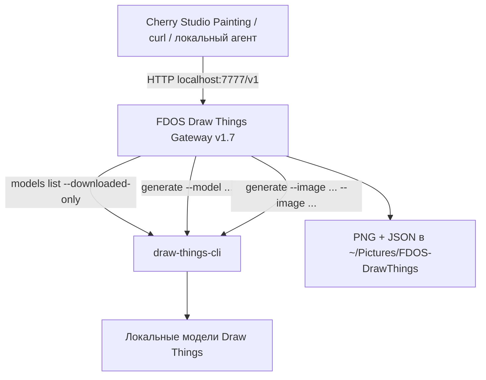

# FDOS Draw Things Gateway v1.7

> [!abstract] Назначение
> Локальный шлюз **Cherry Studio / OpenAI Image API → FDOS Gateway → Draw Things CLI** для генерации и редактирования изображений на Mac. Один провайдер, один порт `7777`, обнаружение установленных моделей, размеры 1K / 2K / 4K, пропорции через меню Cherry Studio, до 10 изображений-референсов.
>
> **Версия 1.7 не требует DHTServer** (порт `7766`), Docker, облачного сервиса или отдельной службы Draw Things. `draw-things-cli` вызывается как локальная программа для каждого задания. Видео LTX в эту версию не включено.

## 1. Архитектура и состав



| Компонент | Назначение | Адрес / расположение |
|---|---|---|
| Draw Things.app | Установка и хранение моделей; удобное управление ими | `/Applications/Draw Things.app` |
| `draw-things-cli` | Локальное выполнение генерации и редактирования | Обычно `/opt/homebrew/bin/draw-things-cli` |
| FDOS Gateway v1.7 | HTTP-адаптер OpenAI Image API для Cherry Studio | `http://127.0.0.1:7777` |
| Папка Gateway | Исходники, настройки, launcher | `~/Apps/fdos-drawthings-gateway-v17/` |
| Папка результатов | Изображения и метаданные | `~/Pictures/FDOS-DrawThings/` |
| LaunchAgent | Автозапуск Gateway после входа в macOS | `~/Library/LaunchAgents/com.fdos.drawthings.gateway.plist` |

> [!important] Проверенная конфигурация
> На машине FDOS подтверждены `GET /health → status: ok`, `backend: draw-things-cli`, шесть моделей изображений, а также успешное редактирование с одним и несколькими референсами на предшествующей v1.6. Роутинг v1.7 реализован через CLI. **Отображение результатов в обычном чате Cherry Studio окончательно не проверено**; Painting — основной подтверждённый сценарий.

## 2. Требования

- Mac с Apple Silicon; для тяжёлых моделей нужно достаточно объединённой памяти. Контрольная конфигурация: MacBook Air M5, 24 ГБ.
- macOS, Homebrew, Python 3 (`/usr/bin/python3` на проверенном Mac), Xcode Command Line Tools (`clang`) — последний нужен только для собственного имени фоновой службы.
- Установленные модели Draw Things в стандартном каталоге:

```text
~/Library/Containers/com.liuliu.draw-things/Data/Documents/Models
```

- Для редактирования **обновлённый CLI** должен показывать в `draw-things-cli generate --help` параметры `--image` (повторяемый), `--crop`, `--offline`, `--output`, `--disable-preview`.

## 3. Установка Draw Things и CLI с нуля

### 3.1. Проверить Homebrew

```bash
brew --version
```

Если Homebrew отсутствует, установите его по официальной инструкции: https://brew.sh/ . На Apple Silicon путь установки обычно `/opt/homebrew/bin`.

### 3.2. Установить Draw Things.app

```bash
brew install --cask draw-things
```

Либо установить через https://drawthings.ai/ . Запустить приложение, скачать требуемые модели через его интерфейс. **Gateway не загружает модели автоматически.**

### 3.3. Установить Draw Things CLI

В первую очередь подходит стабильная формула Homebrew:

```bash
brew install draw-things-cli
```

Проверить:

```bash
command -v draw-things-cli
draw-things-cli --version
draw-things-cli generate --help
draw-things-cli models list --downloaded-only
```

**Важно:** поддержка нескольких `--image` зависит от версии CLI. Если установленная версия не содержит нужные параметры, можно обновить:

```bash
brew update
brew upgrade draw-things-cli
```

Если стабильная версия ещё не поддерживает нужную функцию, официальный репозиторий также описывает вариант сборки из HEAD:

```bash
brew install --HEAD drawthingsai/draw-things/draw-things-cli
```

> [!warning] Осторожно с `--HEAD`
> Это сборка из текущего исходного кода, она может быть менее стабильной и требует инструментария сборки. Не устанавливайте параллельно разные сборки вслепую; сначала проверьте `brew list --versions draw-things-cli`, `brew info draw-things-cli` и текущую справку CLI. Если существующий CLI уже работает с `--image`, обновлять его не нужно.

### 3.4. Проверить модели

```bash
draw-things-cli models list --downloaded-only
```

На проверенной машине обнаружены следующие **модели изображений**:

| ID модели | Тип |
|---|---|
| `z_image_turbo_1.0_i8x.ckpt` | Z Image Turbo |
| `flux_2_klein_4b_i8x.ckpt` | FLUX.2 Klein 4B |
| `flux_2_klein_9b_kv_i8x.ckpt` | FLUX.2 Klein 9B KV |
| `flux_3_klein_i8x.ckpt` | FLUX.3 Klein |
| `krea_2_turbo_i8x.ckpt` | Krea 2 Turbo |
| `qwen_image_2.1_i4x.ckpt` | Qwen Image 2.1 |

`ltx_2.3_22b_distilled_1.1_q6p.ckpt` — видеомодель, **автоматически исключается** из Painting Gateway v1.7. Новые поддерживаемые модели изображений появятся после установки и повторной синхронизации Cherry Studio.

### 3.5. Проверка CLI без Gateway

```bash
mkdir -p "$HOME/Pictures/FDOS-DrawThings"

draw-things-cli generate \
  --local --offline --no-download-missing \
  --model z_image_turbo_1.0_i8x.ckpt \
  --prompt "A red apple on a wooden table, cinematic light" \
  --width 1024 --height 1024 \
  --disable-preview \
  --output "$HOME/Pictures/FDOS-DrawThings/cli-smoke-test.png"
```

Проверить файл:

```bash
open "$HOME/Pictures/FDOS-DrawThings/cli-smoke-test.png"
```

`--offline` и `--no-download-missing` означают, что генерация должна использовать уже установленные модели; сеть для выполнения не требуется. Это не запрещает другим приложениям проверять свои обновления.

## 4. Установка FDOS Gateway v1.7

### 4.1. Получить архив

Нужен проверенный архив **`FDOS-DrawThings-Gateway-v1.7.zip`** из проекта FDOS. Архив содержит `gateway.py`, `gateway_config.json`, `panel.html`, `START.command` и тесты.

Поместить архив в `~/Downloads`, затем:

```bash
mkdir -p "$HOME/Apps"
unzip -o "$HOME/Downloads/FDOS-DrawThings-Gateway-v1.7.zip" -d "$HOME/Apps"

# Архив содержит каталог с точкой: v1.7.
# Приводим его к проверенному имени установки v17.
if [ -d "$HOME/Apps/fdos-drawthings-gateway-v1.7" ] && [ ! -e "$HOME/Apps/fdos-drawthings-gateway-v17" ]; then
  mv "$HOME/Apps/fdos-drawthings-gateway-v1.7" "$HOME/Apps/fdos-drawthings-gateway-v17"
fi
```

Убедиться, что файлы находятся в папке:

```bash
ls -la "$HOME/Apps/fdos-drawthings-gateway-v17"
```

> [!note] Название папки
> ZIP распространяется с папкой **`fdos-drawthings-gateway-v1.7`**, а в проверенной установке FDOS служба ссылается на **`fdos-drawthings-gateway-v17`**. Команда выше выполняет переименование. Если папка `v17` уже существует, скрипт её не перезаписывает: сравните версии и перенесите файлы осознанно, чтобы не сломать работающую службу.

### 4.2. Проверить настройки

```bash
cat "$HOME/Apps/fdos-drawthings-gateway-v17/gateway_config.json"
```

Пример проверенной конфигурации:

```json
{
  "model_aliases": {
    "gpt-image-1": "z_image_turbo_1.0_i8x.ckpt"
  },
  "resolution_profile": "true_4k",
  "default_aspect_ratio": "1:1",
  "default_image_size": "1K",
  "debug_log_requests": true,
  "max_side": 4096,
  "save_directory": "~/Pictures/FDOS-DrawThings"
}
```

Не путать алиас `gpt-image-1` с реальной моделью: алиас указывает на локальную Z Image Turbo. Параметр `true_4k` не гарантирует, что всякая модель поместится в памяти на 4K.

### 4.3. Ручной запуск (до установки автозапуска)

Убедиться, что прежний Gateway остановлен (в его Терминале `Control+C`), затем:

```bash
cd "$HOME/Apps/fdos-drawthings-gateway-v17"
/usr/bin/python3 gateway.py
```

В другом окне Терминала:

```bash
curl -fsS 'http://127.0.0.1:7777/health' | python3 -m json.tool
```

Ожидаемый ответ содержит:

```json
{
  "status": "ok",
  "backend": "draw-things-cli",
  "models_count": 6,
  "cli": "/opt/homebrew/bin/draw-things-cli"
}
```

Дополнительные поля, например `config_path`, допускаются. Число моделей зависит от установленных изображений; шесть — только пример с проверенной машины.

> [!tip] Вставка команд
> Копируйте **только текст из кодовых блоков**: `curl -fsS 'http://127.0.0.1:7777/health'`. Не вставляйте в zsh текст оформленной Markdown-ссылки вида `[http://...](http://...)` — это не адрес и команда может завершиться ошибкой.

## 5. Автозапуск через LaunchAgent macOS

Эта инструкция устанавливает Gateway **после входа пользователя в macOS**, без фонового DHTServer. Для удобного названия службы используется собственный маленький исполняемый launcher, который вызывает Python.

### 5.1. Установить launcher с читаемым именем

```bash
APP="$HOME/Apps/fdos-drawthings-gateway-v17"
mkdir -p "$APP" "$HOME/Library/LaunchAgents" "$HOME/Library/Logs/FDOS"

cat > "$APP/fdos-launcher.c" <<'EOF'
#include <unistd.h>
#include <stdio.h>
int main(void) {
    char *args[] = {
        "/usr/bin/python3",
        "/Users/efim/Apps/fdos-drawthings-gateway-v17/gateway.py",
        NULL
    };
    execv("/usr/bin/python3", args);
    perror("FDOS Draw Things Gateway");
    return 127;
}
EOF

clang -O2 "$APP/fdos-launcher.c" -o "$APP/FDOS Draw Things Gateway"
```

**Путь `/Users/efim/` в C-коде относится к эталонной установке FDOS.** На другом Mac замените его на домашний каталог соответствующего пользователя. Этот исполняемый файл нужен для имени службы и не является новой реализацией генератора.

### 5.2. Создать файл службы

```bash
PLIST="$HOME/Library/LaunchAgents/com.fdos.drawthings.gateway.plist"

cat > "$PLIST" <<'EOF'
<?xml version="1.0" encoding="UTF-8"?>
<!DOCTYPE plist PUBLIC "-//Apple//DTD PLIST 1.0//EN"
 "http://www.apple.com/DTDs/PropertyList-1.0.dtd">
<plist version="1.0">
<dict>
  <key>Label</key>
  <string>com.fdos.drawthings.gateway</string>
  <key>ProgramArguments</key>
  <array>
    <string>/Users/efim/Apps/fdos-drawthings-gateway-v17/FDOS Draw Things Gateway</string>
  </array>
  <key>WorkingDirectory</key>
  <string>/Users/efim/Apps/fdos-drawthings-gateway-v17</string>
  <key>EnvironmentVariables</key>
  <dict>
    <key>PATH</key>
    <string>/opt/homebrew/bin:/usr/local/bin:/usr/bin:/bin</string>
    <key>PYTHONUNBUFFERED</key>
    <string>1</string>
  </dict>
  <key>RunAtLoad</key><true/>
  <key>KeepAlive</key>
  <dict><key>SuccessfulExit</key><false/></dict>
  <key>ThrottleInterval</key><integer>15</integer>
  <key>StandardOutPath</key>
  <string>/Users/efim/Library/Logs/FDOS/drawthings-gateway.log</string>
  <key>StandardErrorPath</key>
  <string>/Users/efim/Library/Logs/FDOS/drawthings-gateway-error.log</string>
</dict>
</plist>
EOF

plutil -lint "$PLIST"
```

> [!warning] Только один процесс на порту
> Перед запуском LaunchAgent остановите Gateway, запущенный вручную, иначе оба процесса попытаются занять порт `7777`.

### 5.3. Активировать службу

```bash
SERVICE="gui/$(id -u)/com.fdos.drawthings.gateway"
PLIST="$HOME/Library/LaunchAgents/com.fdos.drawthings.gateway.plist"

launchctl bootout "$SERVICE" 2>/dev/null || true
launchctl bootstrap "gui/$(id -u)" "$PLIST"
launchctl enable "$SERVICE"
launchctl kickstart -k "$SERVICE"
```

Проверки:

```bash
launchctl print "gui/$(id -u)/com.fdos.drawthings.gateway"
curl -fsS 'http://127.0.0.1:7777/health' | python3 -m json.tool
```

В выводе `launchctl print` ожидается `state = running` и путь к исполняемому `FDOS Draw Things Gateway`. В графическом списке фоновых служб macOS название может оставаться старым из-за кэша: точная подпись в GUI **не гарантируется** одним переименованием бинарника.

### 5.4. Управление службой

**Перезапуск:**

```bash
launchctl kickstart -k "gui/$(id -u)/com.fdos.drawthings.gateway"
```

**Остановить до следующего входа / загрузки службы:**

```bash
launchctl bootout "gui/$(id -u)/com.fdos.drawthings.gateway"
```

**Вернуть после остановки:**

```bash
launchctl bootstrap "gui/$(id -u)" \
  "$HOME/Library/LaunchAgents/com.fdos.drawthings.gateway.plist"
```

**Просмотреть журнал работы / ошибок:**

```bash
tail -f "$HOME/Library/Logs/FDOS/drawthings-gateway.log"
```

```bash
tail -60 "$HOME/Library/Logs/FDOS/drawthings-gateway-error.log"
```

### 5.5. Удаление автозапуска (не удаляет модели или PNG)

```bash
launchctl bootout "gui/$(id -u)/com.fdos.drawthings.gateway" 2>/dev/null || true
rm "$HOME/Library/LaunchAgents/com.fdos.drawthings.gateway.plist"
```

Не удаляйте `~/Pictures/FDOS-DrawThings`, если нужны уже созданные изображения.

## 6. Подключение Cherry Studio

1. Открыть настройки Cherry Studio → **Model Providers**.
2. Создать или выбрать провайдер **FDOS Draw Things** (совместимый с OpenAI API).
3. Базовый URL: `http://127.0.0.1:7777/v1`.
4. Если приложение требует API key, использовать локальное произвольное значение; **шлюз на localhost не проверяет ключ**. Не вводить реальный платный API-ключ.
5. Нажать **Sync Models**. Для Painting использовать варианты с `gpt-image-1@fdos--...--1k` / `--2k` / `--4k`, назначив им тип Image Generation, если Cherry не определила его автоматически.
6. Для редактирования использовать профиль модели, оканчивающийся на `--edit`, например `gpt-image-1@fdos--flux_3_klein_i8x.ckpt--1k--edit`.

**Никакие дополнительные порты и провайдеры не требуются.** Автоматический список моделей получает сама v1.7 через CLI.

### Размеры и ориентации

В модели выбирается **только 1K / 2K / 4K**, а в меню Cherry — ориентация.

| Размер в меню Cherry / поле API `size` | Реальный смысл | 1K | 2K | 4K |
|---|---|---|---|---|
| `1024x1024` | 1:1 | 1024×1024 | 2048×2048 | 4096×4096 |
| `1536x1024` | 16:9 | 1024×576 | 2048×1152 | 4096×2304 |
| `1024x1536` | 9:16 | 576×1024 | 1152×2048 | 2304×4096 |

> [!important] `size` не означает буквальный размер PNG
> Для виртуальных моделей `gpt-image-1@fdos--...` поле `size` используется **как указатель пропорций**, а настоящий размер определяется суффиксом `--1k`, `--2k`, `--4k`.

## 7. HTTP API: адреса и форматы

| Метод / endpoint | Назначение |
|---|---|
| `GET /health` | Проверка сервера и CLI |
| `GET /v1/models` | Список моделей и виртуальных профилей |
| `POST /v1/images/generations` | Создание изображения из промпта |
| `POST /v1/images/edits` | Редактирование; одно или несколько исходных изображений |
| `POST /v1/chat/completions` | Экспериментальная генерация из чата (профиль `fdos-chat--...`) |
| `GET /generated/<filename>` | Получить сохранённый PNG по локальному HTTP URL |
| `GET /panel` | Дополнительная локальная панель; не обязательна для Cherry |

Сервер слушает только **`127.0.0.1:7777`**. Это локальный шлюз, а не внешний веб-сервис.

### 7.1. Получить модели

```bash
curl -fsS 'http://127.0.0.1:7777/v1/models' | python3 -m json.tool
```

Вывести только ID без огромного JSON:

```bash
curl -fsS 'http://127.0.0.1:7777/v1/models' | \
python3 -c 'import json,sys; [print(m["id"]) for m in json.load(sys.stdin)["data"]]'
```

Установленные модели включают три основные размерные профиля на каждую модель, дополнительные профили Edit и экспериментальные профили Chat. Поэтому общее число записей в `/v1/models` **больше шести**.

### 7.2. Генерация из текста: `curl`

```bash
curl -fsS --max-time 1200 \
  'http://127.0.0.1:7777/v1/images/generations' \
  -H 'Content-Type: application/json' \
  -d '{
    "model": "gpt-image-1@fdos--z_image_turbo_1.0_i8x.ckpt--1k",
    "prompt": "Cinematic still: an empty railway station at dawn, soft mist",
    "size": "1536x1024",
    "n": 1,
    "response_format": "b64_json"
  }' \
  -o /tmp/fdos-response.json
```

Сохранить PNG из Base64-ответа:

```bash
python3 - <<'PY'
import base64, json
from pathlib import Path
response = json.loads(Path('/tmp/fdos-response.json').read_text())
if 'error' in response:
    raise SystemExit(response['error'])
out = Path.home() / 'Pictures' / 'FDOS-DrawThings' / 'curl-test.png'
out.parent.mkdir(parents=True, exist_ok=True)
out.write_bytes(base64.b64decode(response['data'][0]['b64_json']))
print('Saved:', out)
PY
```

> [!tip] Сервер сохраняет файл сам
> Gateway автоматически создаёт PNG и соседний JSON в `~/Pictures/FDOS-DrawThings`. Шаг декодирования выше — **дополнительная копия из HTTP-ответа**, полезная для сторонних клиентов и скриптов.

### 7.3. То же через FLUX.3 2K, вертикально

Измените `model` и `size`:

```json
{
  "model": "gpt-image-1@fdos--flux_3_klein_i8x.ckpt--2k",
  "prompt": "Portrait of a woman standing on an abandoned platform, cinematic, natural light",
  "size": "1024x1536",
  "n": 1
}
```

Ожидаемые целевые размеры: **1152 × 2048**. На Mac с 24 ГБ такой запуск может быть значительно медленнее 1K.

### 7.4. Редактировать одну фотографию через multipart `curl`

Подготовьте исходный файл, например `~/Pictures/person.png`. Для CLI первая фотография — основной canvas при совпадении пропорций; при необходимости Gateway добавляет `--crop` (см. раздел 8).

```bash
curl -fsS --max-time 1200 \
  -X POST 'http://127.0.0.1:7777/v1/images/edits' \
  -F 'model=gpt-image-1@fdos--flux_3_klein_i8x.ckpt--1k--edit' \
  -F 'prompt=Change the dress to a red swimsuit. Preserve face, pose and lighting.' \
  -F 'size=1024x1536' \
  -F 'n=1' \
  -F "image=@$HOME/Pictures/person.png" \
  -o /tmp/fdos-edit.json
```

Ответ также содержит Base64 в `data[0].b64_json`; скрипт из §7.2 можно применить к `/tmp/fdos-edit.json` (заменив имя входного JSON).

### 7.5. Несколько референсов: человек + одежда + локация

```bash
curl -fsS --max-time 1200 \
  -X POST 'http://127.0.0.1:7777/v1/images/edits' \
  -F 'model=gpt-image-1@fdos--flux_3_klein_i8x.ckpt--1k--edit' \
  -F 'prompt=Use image 1 as the person and composition. Replace clothing with the exact outfit from image 2. Replace the background with the location shown in image 3. Preserve facial identity, pose and natural lighting.' \
  -F 'size=1536x1024' \
  -F "image=@$HOME/Pictures/person.png" \
  -F "image=@$HOME/Pictures/clothing.png" \
  -F "image=@$HOME/Pictures/location.png" \
  -o /tmp/fdos-three-references.json
```

**Порядок файлов важен.** В Gateway v1.7 первая фотография передаётся CLI первой; две другие становятся референсами moodboard. До 10 изображений на запрос; реальная способность модели использовать каждый референс определяется самой моделью и промптом.

### 7.6. JSON-вариант редактирования (для n8n / Python / агентов)

`POST /v1/images/edits` также принимает `application/json`:

```json
{
  "model": "gpt-image-1@fdos--flux_3_klein_i8x.ckpt--1k--edit",
  "prompt": "Replace the shirt with the outfit in image 2",
  "size": "1024x1536",
  "images": [
    "data:image/png;base64,<BASE64_OF_FIRST_PNG>",
    "data:image/png;base64,<BASE64_OF_SECOND_PNG>"
  ]
}
```

Значения `<BASE64_...>` здесь обозначают **место для реальных данных**. Если файлы лежат на диске, используйте multipart из §7.5 — не нужно вручную кодировать изображения.

### 7.7. Простой вызов из чата через `curl` (экспериментально)

```bash
curl -fsS --max-time 1200 \
  'http://127.0.0.1:7777/v1/chat/completions' \
  -H 'Content-Type: application/json' \
  -d '{
    "model": "fdos-chat--flux_3_klein_i8x.ckpt--1k",
    "messages": [{"role": "user", "content": "Create a film still of a foggy railway platform, 16:9"}],
    "stream": false
  }' \
  -o /tmp/fdos-chat-response.json

python3 - <<'PY'
import json
from pathlib import Path
result = json.loads(Path('/tmp/fdos-chat-response.json').read_text())
if 'error' in result:
    raise SystemExit(result['error'])
print(result['choices'][0]['message']['content'])
PY
```

В данном режиме ответ содержит **текст с локальной Markdown-ссылкой на изображение**, а не сам PNG в поле `content`. Реальное отображение картинки внутри обычного чата Cherry Studio зависит от клиента и не подтверждено полностью. Для автоматизации с картинками надёжнее обращаться к `/v1/images/generations` и `/v1/images/edits`.

### 7.8. Посмотреть локальный PNG через HTTP

Если в каталоге есть файл `FDOS_....png`, его можно открыть по адресу:

```text
http://127.0.0.1:7777/generated/FDOS_....png
```

Пример (заменить имя реальным):

```bash
curl -f 'http://127.0.0.1:7777/generated/FILE_NAME.png' \
  -o "$HOME/Downloads/fdos-from-http.png"
```

## 8. Как правильно пользоваться редактированием / moodboard

### Canvas и moodboard — не одно и то же

- **Первая фотография**: предпочтительно исходный человек/кадр/композиция.
- **Вторая фотография**: конкретный элемент, например костюм.
- **Третья фотография**: конкретная локация, а не лист из множества мелких примеров.
- **Промпт**: явно назначить роли `image 1`, `image 2`, `image 3` и перечислить, что сохранить, а что изменить.

Если выбранное выходное соотношение сторон отличается от пропорций первого референса, Gateway добавляет `--crop`. В CLI это **принудительно закрепляет первую фотографию как canvas с центральным кадрированием**. Поэтому можно потерять части исходного кадра. Если соотношения сторон совпадают, CLI может использовать первый снимок как холст без `--crop`.

> [!success] Подтверждённый сценарий FDOS
> На FLUX.3 Klein получился новый кадр: человек с фото 1, красный купальник с фото 2 и железнодорожная станция с фото 3. Когда третьим референсом был сложный интерьерный мудборд, перенос фона оказался неудачным. Для надёжного композиционного переноса лучше использовать **один понятный кадр локации**.

**Рекомендуемый порядок работы:** сначала 1K → проверка композиции и одежды → при необходимости второй проход → только затем 2K. Высокое разрешение может требовать существенно больше времени и памяти.

## 9. Настройки и метаданные

`gateway_config.json`:

| Поле | Назначение |
|---|---|
| `model_aliases` | Псевдонимы OpenAI → реальные ID CLI |
| `resolution_profile` | Настройки размера для старых/прямых профилей; виртуальные 1K/2K/4K имеют собственную таблицу |
| `default_aspect_ratio` | Пропорция, когда запрос не прислал `size` |
| `default_image_size` | Размер по умолчанию для не-профильных запросов |
| `debug_log_requests` | Логи промптов и параметров запросов — отключить, если в них чувствительные данные |
| `max_side` | Верхняя граница стороны PNG в Gateway |
| `save_directory` | Путь сохранения PNG и JSON |

В метаданных JSON около изображения записываются модель, текст запроса, целевой/фактический размер, tier, способ определения размера, число референсов и параметры выполнения. **Сами исходные фотографии в соседний JSON не копируются**; временные файлы референсов удаляются после выполнения CLI.

## 10. Диагностика и известные ограничения

| Симптом | Что проверить / сделать |
|---|---|
| `curl ... /health` возвращает пустоту | `launchctl print ...`, порт `7777`, журналы LaunchAgent; проверьте, что ссылка в терминале — обычный URL, а не Markdown |
| `Address already in use` | Запущены два Gateway; остановить старый ручной процесс и проверить `lsof -nP -iTCP:7777 -sTCP:LISTEN` |
| `/health` — `models_count: 0` или ошибка | `draw-things-cli models list --downloaded-only`, версия CLI, установлен ли файл модели, не изменился ли формат табличного вывода CLI |
| Модель не появляется в Cherry | `GET /v1/models`, затем **Sync Models**; проверить тип Image Generation |
| Редактирование создаёт изображение, но Cherry не показывает его | Проверить `[saved]` / HTTP-код / время; клиент может завершить ожидание раньше генерации |
| `422` или неправильный маршрут | Для изменения исходной фотографии нужен **`POST /v1/images/edits`**, не `/v1/images/generations`; нужен профиль `--edit` |
| `502` или `draw-things-cli failed` | Смотреть терминальный/LaunchAgent-лог; проверить ту же модель прямой CLI-командой; недостаток ресурсов или несовместимость настроек конкретной модели |
| `curl: (28) Operation timed out` | Увеличить `--max-time`, использовать 1K; сервер может продолжать работу, пока клиент уже отключился |
| Случайное обрезание первого изображения | Формат отличается от оригинала → Gateway добавил `--crop`; для сохранения кадра подбирайте такой же аспект |
| Получился исходный фон вместо третьего референса | Использовать один чёткий снимок локации, указать роли фото в промпте; модель не гарантирует полный перенос |
| В Login Items написано `python3` | Проверить исполняемый файл LaunchAgent; GUI macOS может кэшировать старое отображаемое имя |
| В фоне появляется `zsh: command not found: #` | В интерактивном zsh комментарии иногда выполняются как команды; копировать код без строк-комментариев или `setopt interactivecomments` |

**Диагностический набор:**

```bash
launchctl print "gui/$(id -u)/com.fdos.drawthings.gateway" | head -45
lsof -nP -iTCP:7777 -sTCP:LISTEN
curl -fsS 'http://127.0.0.1:7777/health' | python3 -m json.tool
draw-things-cli models list --downloaded-only
tail -50 "$HOME/Library/Logs/FDOS/drawthings-gateway.log"
tail -50 "$HOME/Library/Logs/FDOS/drawthings-gateway-error.log"
```

> [!warning] Ограничения v1.7
> - Профили Edit публикуются для скачанных моделей автоматически, но **не каждая модель обязательно умеет корректно редактировать**.
> - Видео LTX не включено.
> - Одновременные тяжёлые задания могут конкурировать за общую память Mac; не запускайте их массово без контроля очереди.
> - CLI-процесс для отдельного задания имеет ограничение ожидания около **900 секунд** в текущем коде v1.7; `curl --max-time 1200` сам по себе его не отменяет.
> - Gateway доступен только на `127.0.0.1`. Не открывать порт в интернет без отдельной аутентификации и защитных мер.
> - Встроенный обычный Chat-маршрут — экспериментальный; Cherry Studio может по-разному обрабатывать вложения и локальные ссылки.

## 11. Резервное копирование и обновления

**Сохранять:**

```text
~/Apps/fdos-drawthings-gateway-v17/
~/Library/LaunchAgents/com.fdos.drawthings.gateway.plist
~/Pictures/FDOS-DrawThings/
```

Для обновления Gateway: сохранить старую версию как резервную, распаковать новую рядом, протестировать вручную на альтернативном порту (через переменную `FDOS_GATEWAY_PORT`), затем только после успешного теста изменить путь в LaunchAgent и перезапустить службу. **Не перезаписывать рабочую v1.7 вслепую.**

Для обновления CLI:

```bash
brew update
brew upgrade draw-things-cli
```

После обновления обязательно проверить `draw-things-cli generate --help` и работу референсов — CLI способен менять поведение между версиями. Gateway v1.7 парсит табличный вывод `models list --downloaded-only`, а не формальный JSON API; это ещё одна точка совместимости.

## 12. Быстрая памятка

```bash
# CLI
command -v draw-things-cli
draw-things-cli models list --downloaded-only

# FDOS Gateway
curl -fsS 'http://127.0.0.1:7777/health' | python3 -m json.tool
curl -fsS 'http://127.0.0.1:7777/v1/models' | python3 -m json.tool

# macOS LaunchAgent
launchctl print "gui/$(id -u)/com.fdos.drawthings.gateway"
launchctl kickstart -k "gui/$(id -u)/com.fdos.drawthings.gateway"

tail -f "$HOME/Library/Logs/FDOS/drawthings-gateway.log"
```

---

## 13. Источники и связанные материалы

- [Draw Things — официальный сайт](https://drawthings.ai/)
- [Draw Things Community — README / CLI](https://github.com/drawthingsai/draw-things-community#quick-start-with-draw-things-cli-on-macos)
- [Homebrew formula: draw-things-cli](https://formulae.brew.sh/formula/draw-things-cli)
- [Homebrew cask: Draw Things](https://formulae.brew.sh/cask/draw-things)
- **Локальный исходный код FDOS**: `gateway.py` и `test_v17.py` из архива `FDOS-DrawThings-Gateway-v1.7.zip`.
- **Локальная справка CLI**: `draw-things-cli generate --help` на проверенном Mac, включая `--image`, `--crop`, `--offline`, `--output`.

**Статус на 2026-11-08:** Gateway v1.7 на постоянной службе `com.fdos.drawthings.gateway`, backend `draw-things-cli`, шесть установленных моделей изображений, HTTP `/health` возвращает `200`.
