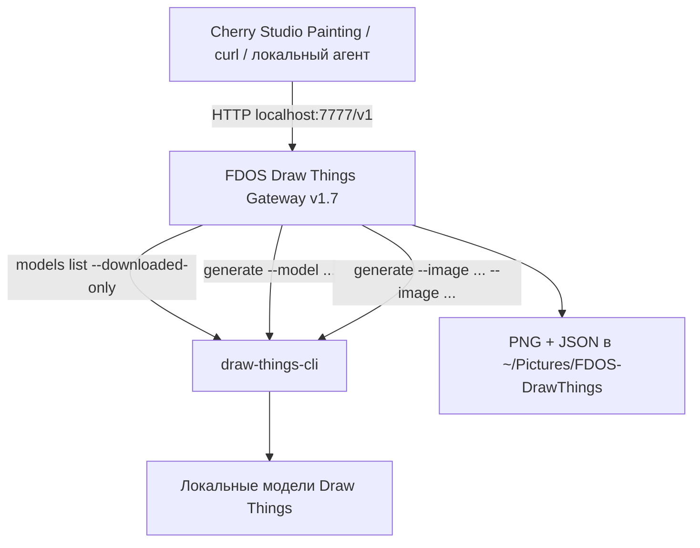

# FDOS Draw Things Gateway v1.7

> [!abstract] Purpose
> A **local OpenAI-compatible image gateway** connecting Cherry Studio Painting, command-line HTTP clients and automation tools to Draw Things CLI on macOS. One provider and one port (`7777`), automatic model discovery, 1K/2K/4K presets, aspect-ratio selection through Cherry Studio's size menu, and up to ten input reference images.
>
> **v1.7 does not use DHTServer** (port `7766`), Docker, a cloud image API, or a separate Draw Things server. Each job is executed by the local `draw-things-cli` program. LTX video generation is not included.

## 1. Architecture and components



| Component | Purpose | Location |
|---|---|---|
| Draw Things.app | Download and manage local models | `/Applications/Draw Things.app` |
| `draw-things-cli` | Generate and edit images locally | Usually `/opt/homebrew/bin/draw-things-cli` |
| FDOS Gateway v1.7 | OpenAI-compatible HTTP adapter | `http://127.0.0.1:7777` |
| Gateway directory | Code, configuration and launcher | `~/Apps/fdos-drawthings-gateway-v17/` |
| Output directory | Generated images and JSON metadata | `~/Pictures/FDOS-DrawThings/` |
| LaunchAgent | Starts after user logs into macOS | `~/Library/LaunchAgents/com.fdos.drawthings.gateway.plist` |

> [!important] Validation status
> On the reference Mac, `GET /health` returned `status: ok`, `backend: draw-things-cli` and six image models. Single- and multi-reference edits succeeded with the preceding v1.6; v1.7 uses the native CLI for all image routes. **Displaying the image directly inside a regular Cherry Studio chat is not fully validated**; Painting is the main working mode.

## 2. Requirements

- An Apple Silicon Mac and sufficient unified memory for the chosen image model (reference machine: MacBook Air M5, 24 GB).
- macOS, Homebrew and Python 3. The reference installation uses `/usr/bin/python3`. Xcode Command Line Tools (`clang`) are needed only to compile the optional named background-service launcher.
- Locally downloaded Draw Things models in the standard directory:

```text
~/Library/Containers/com.liuliu.draw-things/Data/Documents/Models
```

- An **up-to-date Draw Things CLI** whose `draw-things-cli generate --help` supports repeated `--image`, `--crop`, `--offline`, `--output` and `--disable-preview`.

## 3. Installing Draw Things and its CLI

### 3.1. Check Homebrew

```bash
brew --version
```

Install from https://brew.sh/ if missing. Apple Silicon Homebrew commonly installs into `/opt/homebrew`.

### 3.2. Install Draw Things.app

```bash
brew install --cask draw-things
```

Alternatively download it from https://drawthings.ai/. Open the app and download the image models you intend to use. **The gateway does not automatically download models.**

### 3.3. Install the CLI

```bash
brew install draw-things-cli
```

Verify the installation, version, supported flags and installed models:

```bash
command -v draw-things-cli
draw-things-cli --version
draw-things-cli generate --help
draw-things-cli models list --downloaded-only
```

The repeated `--image` option is version-dependent. If it is missing, update the formula:

```bash
brew update
brew upgrade draw-things-cli
```

If the stable formula is behind, the project also documents a HEAD build:

```bash
brew install --HEAD drawthingsai/draw-things/draw-things-cli
```

> [!warning] Using `--HEAD`
> HEAD tracks current source code and can be less stable. Inspect `brew info draw-things-cli` and `brew list --versions draw-things-cli` first. **Do not upgrade a working CLI without a reason.**

### 3.4. Verify downloaded models

```bash
draw-things-cli models list --downloaded-only
```

The reference machine has six image models:

| Model ID | Family |
|---|---|
| `z_image_turbo_1.0_i8x.ckpt` | Z Image Turbo |
| `flux_2_klein_4b_i8x.ckpt` | FLUX.2 Klein 4B |
| `flux_2_klein_9b_kv_i8x.ckpt` | FLUX.2 Klein 9B KV |
| `flux_3_klein_i8x.ckpt` | FLUX.3 Klein |
| `krea_2_turbo_i8x.ckpt` | Krea 2 Turbo |
| `qwen_image_2.1_i4x.ckpt` | Qwen Image 2.1 |

The video model `ltx_2.3_22b_distilled_1.1_q6p.ckpt` is **excluded** from the image model list. After downloading additional compatible models, synchronize Cherry Studio again.

### 3.5. Test the CLI without the gateway

```bash
mkdir -p "$HOME/Pictures/FDOS-DrawThings"

draw-things-cli generate \
  --local --offline --no-download-missing \
  --model z_image_turbo_1.0_i8x.ckpt \
  --prompt "A red apple on a wooden table, cinematic light" \
  --width 1024 --height 1024 \
  --disable-preview \
  --output "$HOME/Pictures/FDOS-DrawThings/cli-smoke-test.png"
```

Open the resulting file:

```bash
open "$HOME/Pictures/FDOS-DrawThings/cli-smoke-test.png"
```

`--offline --no-download-missing` forces the CLI to use already installed model assets; it does not prevent unrelated applications from checking for updates.

## 4. Installing FDOS Gateway v1.7

### 4.1. Obtain and unpack the release

Download the checked `FDOS-DrawThings-Gateway-v1.7.zip` archive (containing `gateway.py`, `gateway_config.json`, `panel.html`, `START.command` and tests) into `~/Downloads`.

```bash
mkdir -p "$HOME/Apps"
unzip -o "$HOME/Downloads/FDOS-DrawThings-Gateway-v1.7.zip" -d "$HOME/Apps"

# Архив содержит каталог с точкой: v1.7.
# Приводим его к проверенному имени установки v17.
if [ -d "$HOME/Apps/fdos-drawthings-gateway-v1.7" ] && [ ! -e "$HOME/Apps/fdos-drawthings-gateway-v17" ]; then
  mv "$HOME/Apps/fdos-drawthings-gateway-v1.7" "$HOME/Apps/fdos-drawthings-gateway-v17"
fi
```

Check the extracted directory:

```bash
ls -la "$HOME/Apps/fdos-drawthings-gateway-v17"
```

> [!note] Directory naming
> The ZIP contains `fdos-drawthings-gateway-v1.7`, while the tested LaunchAgent uses `fdos-drawthings-gateway-v17`. The commands above rename the extracted directory if the destination does not already exist. **Do not overwrite an existing working installation blindly.**

### 4.2. Configure the gateway

```bash
cat "$HOME/Apps/fdos-drawthings-gateway-v17/gateway_config.json"
```

Example of the tested configuration:

```json
{
  "model_aliases": {
    "gpt-image-1": "z_image_turbo_1.0_i8x.ckpt"
  },
  "resolution_profile": "true_4k",
  "default_aspect_ratio": "1:1",
  "default_image_size": "1K",
  "debug_log_requests": true,
  "max_side": 4096,
  "save_directory": "~/Pictures/FDOS-DrawThings"
}
```

`gpt-image-1` is an alias for the real local Z Image Turbo model, not an OpenAI-hosted image model. A `true_4k` profile does **not** guarantee that every local model can handle 4K within available memory.

### 4.3. Start manually and verify

Stop any previous gateway occupying port `7777`, then:

```bash
cd "$HOME/Apps/fdos-drawthings-gateway-v17"
/usr/bin/python3 gateway.py
```

In another terminal:

```bash
curl -fsS 'http://127.0.0.1:7777/health' | python3 -m json.tool
```

An example response includes:

```json
{
  "status": "ok",
  "backend": "draw-things-cli",
  "models_count": 6,
  "cli": "/opt/homebrew/bin/draw-things-cli"
}
```

The actual response may contain additional fields such as `config_path`. The model count varies with installed image models.

> [!tip] Pasting terminal commands
> Copy the literal URL inside code blocks, **not** Markdown link syntax like `[http://...](http://...)`.

## 5. macOS LaunchAgent (automatic startup)

The LaunchAgent starts the gateway **when the macOS user logs in**, without requiring a separate DHTServer or terminal window.

### 5.1. Optional named launcher

```bash
APP="$HOME/Apps/fdos-drawthings-gateway-v17"
mkdir -p "$APP" "$HOME/Library/LaunchAgents" "$HOME/Library/Logs/FDOS"

cat > "$APP/fdos-launcher.c" <<'EOF'
#include <unistd.h>
#include <stdio.h>
int main(void) {
    char *args[] = {
        "/usr/bin/python3",
        "/Users/efim/Apps/fdos-drawthings-gateway-v17/gateway.py",
        NULL
    };
    execv("/usr/bin/python3", args);
    perror("FDOS Draw Things Gateway");
    return 127;
}
EOF

clang -O2 "$APP/fdos-launcher.c" -o "$APP/FDOS Draw Things Gateway"
```

> [!warning] User-specific paths
> The C launcher above contains `/Users/efim/`, an absolute path from the reference installation. **Replace it with your own home-directory path before compiling.** This launcher only starts Python under a friendlier executable name; it does not implement image generation.

### 5.2. Create the LaunchAgent plist

```bash
PLIST="$HOME/Library/LaunchAgents/com.fdos.drawthings.gateway.plist"

cat > "$PLIST" <<'EOF'
<?xml version="1.0" encoding="UTF-8"?>
<!DOCTYPE plist PUBLIC "-//Apple//DTD PLIST 1.0//EN"
 "http://www.apple.com/DTDs/PropertyList-1.0.dtd">
<plist version="1.0">
<dict>
  <key>Label</key>
  <string>com.fdos.drawthings.gateway</string>
  <key>ProgramArguments</key>
  <array>
    <string>/Users/efim/Apps/fdos-drawthings-gateway-v17/FDOS Draw Things Gateway</string>
  </array>
  <key>WorkingDirectory</key>
  <string>/Users/efim/Apps/fdos-drawthings-gateway-v17</string>
  <key>EnvironmentVariables</key>
  <dict>
    <key>PATH</key>
    <string>/opt/homebrew/bin:/usr/local/bin:/usr/bin:/bin</string>
    <key>PYTHONUNBUFFERED</key>
    <string>1</string>
  </dict>
  <key>RunAtLoad</key><true/>
  <key>KeepAlive</key>
  <dict><key>SuccessfulExit</key><false/></dict>
  <key>ThrottleInterval</key><integer>15</integer>
  <key>StandardOutPath</key>
  <string>/Users/efim/Library/Logs/FDOS/drawthings-gateway.log</string>
  <key>StandardErrorPath</key>
  <string>/Users/efim/Library/Logs/FDOS/drawthings-gateway-error.log</string>
</dict>
</plist>
EOF

plutil -lint "$PLIST"
```

> [!warning] Replace paths before running
> In this example plist, replace every `/Users/efim/` with your own home path, including the working directory and log paths. Stop the manually started gateway before enabling LaunchAgent; only one process can bind port `7777`.

### 5.3. Enable the service

```bash
SERVICE="gui/$(id -u)/com.fdos.drawthings.gateway"
PLIST="$HOME/Library/LaunchAgents/com.fdos.drawthings.gateway.plist"

launchctl bootout "$SERVICE" 2>/dev/null || true
launchctl bootstrap "gui/$(id -u)" "$PLIST"
launchctl enable "$SERVICE"
launchctl kickstart -k "$SERVICE"
```

Verify:

```bash
launchctl print "gui/$(id -u)/com.fdos.drawthings.gateway"
curl -fsS 'http://127.0.0.1:7777/health' | python3 -m json.tool
```

Look for `state = running` and the configured launcher path. macOS Login Items might show a cached name; merely renaming the binary cannot guarantee the label shown in Settings.

### 5.4. Restart, stop, start, and inspect logs

**Restart:**

```bash
launchctl kickstart -k "gui/$(id -u)/com.fdos.drawthings.gateway"
```

**Stop:**

```bash
launchctl bootout "gui/$(id -u)/com.fdos.drawthings.gateway"
```

**Start again after stopping:**

```bash
launchctl bootstrap "gui/$(id -u)" \
  "$HOME/Library/LaunchAgents/com.fdos.drawthings.gateway.plist"
```

**Standard log:**

```bash
tail -f "$HOME/Library/Logs/FDOS/drawthings-gateway.log"
```

**Error log:**

```bash
tail -60 "$HOME/Library/Logs/FDOS/drawthings-gateway-error.log"
```

### 5.5. Remove automatic startup

```bash
launchctl bootout "gui/$(id -u)/com.fdos.drawthings.gateway" 2>/dev/null || true
rm "$HOME/Library/LaunchAgents/com.fdos.drawthings.gateway.plist"
```

This does not remove the CLI, model files, or generated images. Do not delete `~/Pictures/FDOS-DrawThings/` if you want to keep past outputs.

## 6. Connecting Cherry Studio

1. In Cherry Studio, open **Settings → Model Providers**.
2. Create or select a custom **OpenAI-compatible** provider named **FDOS Draw Things**.
3. Set Base URL to `http://127.0.0.1:7777/v1`.
4. If Cherry requires an API key, use any **dummy local value**; this localhost gateway does not validate the key. Do not enter a paid cloud key.
5. Click **Sync Models**. For Painting, use model IDs starting `gpt-image-1@fdos--` and ending `--1k`, `--2k` or `--4k`. Set the model category to **Image Generation** if not detected automatically.
6. For source-image editing, use a model ID ending in `--edit`, e.g. `gpt-image-1@fdos--flux_3_klein_i8x.ckpt--1k--edit`.

**No additional ports or providers are required.** v1.7 discovers downloaded models with the CLI.

### Resolution and orientation

The model ID specifies **only the model and 1K/2K/4K tier**. Cherry Studio's `size` menu selects the aspect ratio:

| Cherry menu `size` | Aspect | 1K actual | 2K actual | 4K actual |
|---|---|---|---|---|
| `1024x1024` | 1:1 | 1024×1024 | 2048×2048 | 4096×4096 |
| `1536x1024` | 16:9 | 1024×576 | 2048×1152 | 4096×2304 |
| `1024x1536` | 9:16 | 576×1024 | 1152×2048 | 2304×4096 |

> [!important] `size` is an aspect-ratio selector
> For virtual `gpt-image-1@fdos--...` profiles, the API's `size` is **not** the final PNG dimensions. The suffix `--1k`, `--2k` or `--4k` determines the actual target resolution.

## 7. HTTP API and curl examples

The server binds **only to `127.0.0.1:7777`**; it is a local adapter and should not be exposed publicly without authentication and network protections.

| Endpoint | Use |
|---|---|
| `GET /health` | Health check and CLI availability |
| `GET /v1/models` | List models and generated profile IDs |
| `POST /v1/images/generations` | Text-to-image |
| `POST /v1/images/edits` | Image editing, one or many references |
| `POST /v1/chat/completions` | Experimental image chat (`fdos-chat--...` profile) |
| `GET /generated/<filename>` | Read locally saved PNG |
| `GET /panel` | Optional local web panel |

### 7.1. List models

```bash
curl -fsS 'http://127.0.0.1:7777/v1/models' | python3 -m json.tool
```

To print just the IDs:

```bash
curl -fsS 'http://127.0.0.1:7777/v1/models' | \
python3 -c 'import json,sys; [print(m["id"]) for m in json.load(sys.stdin)["data"]]'
```

`/v1/models` includes three standard size profiles per image model, additional Edit profiles, and experimental Chat profiles. The total number of IDs therefore exceeds the number of installed models.

### 7.2. Text-to-image via curl

```bash
curl -fsS --max-time 1200 \
  'http://127.0.0.1:7777/v1/images/generations' \
  -H 'Content-Type: application/json' \
  -d '{
    "model": "gpt-image-1@fdos--z_image_turbo_1.0_i8x.ckpt--1k",
    "prompt": "Cinematic still: an empty railway station at dawn, soft mist",
    "size": "1536x1024",
    "n": 1,
    "response_format": "b64_json"
  }' \
  -o /tmp/fdos-response.json
```

Decode the Base64 API response into a separate PNG:

```bash
python3 - <<'PY'
import base64, json
from pathlib import Path
response = json.loads(Path('/tmp/fdos-response.json').read_text())
if 'error' in response:
    raise SystemExit(response['error'])
out = Path.home() / 'Pictures' / 'FDOS-DrawThings' / 'curl-test.png'
out.parent.mkdir(parents=True, exist_ok=True)
out.write_bytes(base64.b64decode(response['data'][0]['b64_json']))
print('Saved:', out)
PY
```

> [!tip] Automatic saving
> The gateway **already saves** an image and matching JSON metadata in `~/Pictures/FDOS-DrawThings/`. Decoding the response manually creates an optional second copy for scripts and other clients.

### 7.3. FLUX.3, 2K, portrait

Use this payload with `/v1/images/generations`:

```json
{
  "model": "gpt-image-1@fdos--flux_3_klein_i8x.ckpt--2k",
  "prompt": "Portrait of a woman standing on an abandoned platform, cinematic, natural light",
  "size": "1024x1536",
  "n": 1
}
```

The intended output is **1152 × 2048**; on a 24 GB Mac this may be much slower than 1K.

### 7.4. Edit one photograph (multipart)

Prepare `~/Pictures/person.png`, then send:

```bash
curl -fsS --max-time 1200 \
  -X POST 'http://127.0.0.1:7777/v1/images/edits' \
  -F 'model=gpt-image-1@fdos--flux_3_klein_i8x.ckpt--1k--edit' \
  -F 'prompt=Change the dress to a red swimsuit. Preserve face, pose and lighting.' \
  -F 'size=1024x1536' \
  -F 'n=1' \
  -F "image=@$HOME/Pictures/person.png" \
  -o /tmp/fdos-edit.json
```

The response is Base64 in `data[0].b64_json`. To decode it, reuse the Python example in §7.2 with `/tmp/fdos-edit.json` as the input JSON filename.

### 7.5. Three references: person + outfit + location

```bash
curl -fsS --max-time 1200 \
  -X POST 'http://127.0.0.1:7777/v1/images/edits' \
  -F 'model=gpt-image-1@fdos--flux_3_klein_i8x.ckpt--1k--edit' \
  -F 'prompt=Use image 1 as the person and composition. Replace clothing with the exact outfit from image 2. Replace the background with the location shown in image 3. Preserve facial identity, pose and natural lighting.' \
  -F 'size=1536x1024' \
  -F "image=@$HOME/Pictures/person.png" \
  -F "image=@$HOME/Pictures/clothing.png" \
  -F "image=@$HOME/Pictures/location.png" \
  -o /tmp/fdos-three-references.json
```

**File order matters.** The gateway passes the first reference as the first CLI `--image` (usually the canvas); subsequent images act as moodboard references. Up to ten reference images are accepted, but each model's ability to incorporate them is not guaranteed.

### 7.6. JSON image editing for n8n or automation

```json
{
  "model": "gpt-image-1@fdos--flux_3_klein_i8x.ckpt--1k--edit",
  "prompt": "Replace the shirt with the outfit in image 2",
  "size": "1024x1536",
  "images": [
    "data:image/png;base64,<BASE64_OF_FIRST_PNG>",
    "data:image/png;base64,<BASE64_OF_SECOND_PNG>"
  ]
}
```

`<BASE64_...>` represents real image bytes encoded as Base64. When you have local files, multipart upload from §7.5 is much easier.

### 7.7. Experimental chat completion

```bash
curl -fsS --max-time 1200 \
  'http://127.0.0.1:7777/v1/chat/completions' \
  -H 'Content-Type: application/json' \
  -d '{
    "model": "fdos-chat--flux_3_klein_i8x.ckpt--1k",
    "messages": [{"role": "user", "content": "Create a film still of a foggy railway platform, 16:9"}],
    "stream": false
  }' \
  -o /tmp/fdos-chat-response.json

python3 - <<'PY'
import json
from pathlib import Path
result = json.loads(Path('/tmp/fdos-chat-response.json').read_text())
if 'error' in result:
    raise SystemExit(result['error'])
print(result['choices'][0]['message']['content'])
PY
```

The reply includes **text with a local Markdown image link**, rather than raw PNG in `content`. Inline display in Cherry Studio chat is still client-dependent and not fully confirmed. For robust image automation, use `/v1/images/generations` and `/v1/images/edits`.

### 7.8. Retrieve a saved PNG

A saved image is available at a local URL like:

```text
http://127.0.0.1:7777/generated/FDOS_....png
```

Example (replace `FILE_NAME.png` with a real saved filename):

```bash
curl -f 'http://127.0.0.1:7777/generated/FILE_NAME.png' \
  -o "$HOME/Downloads/fdos-from-http.png"
```

## 8. Editing, canvas and moodboard

- **Image 1:** Main character, original shot, or composition.
- **Image 2:** A precise element such as clothing.
- **Image 3:** One specific background/location image, not a collage of many small interiors.
- **Prompt:** Clearly specify which role belongs to `image 1`, `image 2`, `image 3`, what must remain, and what must change.

If output proportions do not match the first image, the gateway adds CLI `--crop` to force the first image to be the canvas with center cropping. This may trim the source frame. If proportions match, the CLI can use the first image as the canvas without `--crop`.

> [!success] Verified creative workflow
> In FLUX.3 Klein, image 1 supplied a person, image 2 a red swimsuit and image 3 a railway-station background. The combination worked. An earlier reference consisting of a complex interior-design collage did not transfer its background as intended. A **single clear location image** tends to work better than a crowded moodboard.

**Recommended sequence:** start with 1K, evaluate costume and composition, iterate if needed, then render 2K. Larger outputs take more time and unified memory.

## 9. Configuration and metadata

`gateway_config.json`:

| Key | Meaning |
|---|---|
| `model_aliases` | OpenAI-style alias to local CLI model ID |
| `resolution_profile` | Resolution policy for legacy/direct IDs; virtual tiers have their own mapping |
| `default_aspect_ratio` | Ratio when a request omits `size` |
| `default_image_size` | Default size for non-profile requests |
| `debug_log_requests` | Logs prompts/parameters; disable for sensitive inputs |
| `max_side` | Maximum allowed output side |
| `save_directory` | Output PNG and JSON location |

Each image's JSON sidecar records model ID, prompt, requested and actual dimensions, resolution tier, reference count, and execution options. **Source photos are not embedded in the JSON**; temporary CLI input files are deleted after the job completes.

## 10. Troubleshooting and limitations

| Symptom | Action |
|---|---|
| Blank `curl /health` | Check LaunchAgent status, port 7777 and logs; avoid pasting Markdown URLs |
| `Address already in use` | Stop any previous gateway; inspect `lsof -nP -iTCP:7777 -sTCP:LISTEN` |
| `models_count: 0` | Check CLI `models list --downloaded-only`, installed models and table output format |
| Model missing in Cherry | Query `/v1/models`, then **Sync Models** and check Image Generation type |
| Edited PNG saved but not shown | Inspect `[saved]`, HTTP status and client timeouts |
| HTTP `422` | Editing must use `/v1/images/edits` and an `--edit` profile |
| HTTP `502` / CLI error | Inspect logs and test the model with the CLI directly; check memory |
| `curl: (28) Operation timed out` | Increase `--max-time`; try 1K first |
| Cropped subject | Output aspect differs from image 1 and `--crop` was used |
| Third background ignored | Use one clear location photo and explicitly assign reference roles |
| Login Items shows `python3` | Check executable; macOS might cache the old name |
| `zsh: command not found: #` | Paste without comment-only lines or run `setopt interactivecomments` |

**Diagnostic commands:**

```bash
launchctl print "gui/$(id -u)/com.fdos.drawthings.gateway" | head -45
lsof -nP -iTCP:7777 -sTCP:LISTEN
curl -fsS 'http://127.0.0.1:7777/health' | python3 -m json.tool
draw-things-cli models list --downloaded-only
tail -50 "$HOME/Library/Logs/FDOS/drawthings-gateway.log"
tail -50 "$HOME/Library/Logs/FDOS/drawthings-gateway-error.log"
```

> [!warning] Known v1.7 limitations
> - Edit profiles are published for downloaded models; **not every model supports meaningful editing**.
> - LTX video is excluded.
> - Concurrent heavy jobs compete for Mac unified memory.
> - Individual CLI jobs have a timeout of approximately **900 seconds**; the longer curl `--max-time` cannot override this server-side limit.
> - The gateway listens on localhost without authentication; do **not** expose it to the public internet.
> - Chat output and attachment rendering in Cherry Studio are experimental.

## 11. Backups and upgrades

Back up the following paths:

```text
~/Apps/fdos-drawthings-gateway-v17/
~/Library/LaunchAgents/com.fdos.drawthings.gateway.plist
~/Pictures/FDOS-DrawThings/
```

When upgrading, keep the tested version as a fallback. Unpack the new version alongside it, test on a different port via `FDOS_GATEWAY_PORT`, then update the LaunchAgent path after successful verification. **Never overwrite the working v1.7 installation without a backup.**

To update the CLI:

```bash
brew update
brew upgrade draw-things-cli
```

After any CLI update, confirm the `generate --help` flags and reference-image behavior. v1.7 parses the human-readable `models list --downloaded-only` table instead of a formal JSON API, so CLI output changes may break model detection.

## 12. Quick reference

```bash
# CLI
command -v draw-things-cli
draw-things-cli models list --downloaded-only

# FDOS Gateway
curl -fsS 'http://127.0.0.1:7777/health' | python3 -m json.tool
curl -fsS 'http://127.0.0.1:7777/v1/models' | python3 -m json.tool

# macOS LaunchAgent
launchctl print "gui/$(id -u)/com.fdos.drawthings.gateway"
launchctl kickstart -k "gui/$(id -u)/com.fdos.drawthings.gateway"

tail -f "$HOME/Library/Logs/FDOS/drawthings-gateway.log"
```

## 13. References

- [Draw Things — official site](https://drawthings.ai/)
- [Draw Things Community — CLI documentation](https://github.com/drawthingsai/draw-things-community#quick-start-with-draw-things-cli-on-macos)
- [Homebrew formula: draw-things-cli](https://formulae.brew.sh/formula/draw-things-cli)
- [Homebrew cask: Draw Things](https://formulae.brew.sh/cask/draw-things)
- **FDOS local source:** `gateway.py` and `test_v17.py` from `FDOS-DrawThings-Gateway-v1.7.zip`.
- **CLI help:** `draw-things-cli generate --help` on the reference Mac, including `--image`, `--crop`, `--offline` and `--output`.

**Status as of 2026-11-08:** v1.7 running as macOS LaunchAgent `com.fdos.drawthings.gateway`, native `draw-things-cli` backend, six downloaded image models, and successful `GET /health` HTTP 200.
