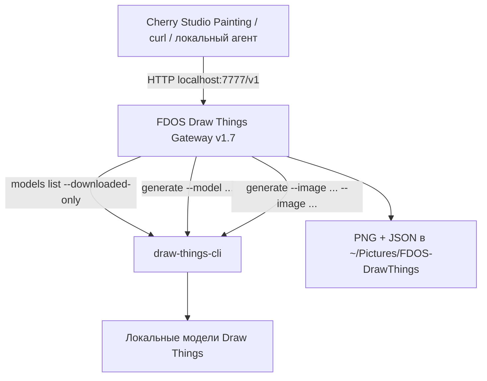

# FDOS Draw Things Gateway v1.7

> [!abstract] 项目用途
> 这是一个在 macOS 上运行的**本地 OpenAI 兼容图像网关**，将 Cherry Studio Painting、`curl` 和自动化工具连接到 Draw Things CLI。只需一个服务提供商和一个端口（`7777`），即可自动发现模型、选择 1K / 2K / 4K 分辨率、通过 Cherry Studio 菜单选择纵横比，并使用最多 10 张参考图。
>
> **v1.7 不需要 DHTServer**（端口 `7766`）、Docker、云端图像 API 或单独的 Draw Things 服务。每次任务均调用本地 `draw-things-cli`。本版本不包含 LTX 视频生成。

## 1. 架构与组件



| 组件 | 用途 | 路径 / 地址 |
|---|---|---|
| Draw Things.app | 下载、管理本地模型 | `/Applications/Draw Things.app` |
| `draw-things-cli` | 本地图像生成与编辑 | 通常为 `/opt/homebrew/bin/draw-things-cli` |
| FDOS Gateway v1.7 | OpenAI 兼容 HTTP 网关 | `http://127.0.0.1:7777` |
| 网关目录 | 源代码、配置与启动器 | `~/Apps/fdos-drawthings-gateway-v17/` |
| 输出目录 | PNG 图像与 JSON 元数据 | `~/Pictures/FDOS-DrawThings/` |
| LaunchAgent | 登录 macOS 后自动启动 | `~/Library/LaunchAgents/com.fdos.drawthings.gateway.plist` |

> [!important] 验证状态
> 参考 Mac 的 `GET /health` 返回了 `status: ok`、`backend: draw-things-cli`，并检测到六个图像模型。上一版 v1.6 已成功完成单图与多图参考编辑；v1.7 的图像请求统一通过 CLI 执行。**普通 Cherry Studio 聊天中的内嵌图像显示尚未充分验证**；Painting 是主要已验证的使用方式。

## 2. 系统要求

- Apple Silicon Mac；大型模型需要足够的统一内存。参考配置为配备 24 GB 内存的 MacBook Air M5。
- macOS、Homebrew 和 Python 3。参考安装使用 `/usr/bin/python3`。仅在编译自定义后台服务启动器时才需要 Xcode Command Line Tools（`clang`）。
- Draw Things 模型已下载到默认目录：

```text
~/Library/Containers/com.liuliu.draw-things/Data/Documents/Models
```

- 使用**较新版本的 Draw Things CLI**。`draw-things-cli generate --help` 应支持可重复的 `--image`、`--crop`、`--offline`、`--output` 和 `--disable-preview`。

## 3. 从零安装 Draw Things 和 CLI

### 3.1. 检查 Homebrew

```bash
brew --version
```

如果尚未安装，请访问 https://brew.sh/ 。Apple Silicon Mac 通常将 Homebrew 安装到 `/opt/homebrew`。

### 3.2. 安装 Draw Things.app

```bash
brew install --cask draw-things
```

也可以从 https://drawthings.ai/ 获取。启动应用并通过图形界面下载所需模型。**网关不会自动下载模型。**

### 3.3. 安装 CLI

```bash
brew install draw-things-cli
```

检查可执行文件、版本、命令选项和已下载模型：

```bash
command -v draw-things-cli
draw-things-cli --version
draw-things-cli generate --help
draw-things-cli models list --downloaded-only
```

不同 CLI 版本对重复 `--image` 参数的支持可能不同。如果缺少该参数，请更新：

```bash
brew update
brew upgrade draw-things-cli
```

如果稳定版尚未支持，也可按官方项目说明尝试 HEAD 版本：

```bash
brew install --HEAD drawthingsai/draw-things/draw-things-cli
```

> [!warning] 关于 `--HEAD`
> HEAD 从最新源代码构建，稳定性可能低于正式版。先检查 `brew info draw-things-cli` 和 `brew list --versions draw-things-cli`。**如果目前的 CLI 已能正常使用多图输入，没有必要升级。**

### 3.4. 检查已下载模型

```bash
draw-things-cli models list --downloaded-only
```

参考机器上有以下六个图像模型：

| 模型 ID | 模型系列 |
|---|---|
| `z_image_turbo_1.0_i8x.ckpt` | Z Image Turbo |
| `flux_2_klein_4b_i8x.ckpt` | FLUX.2 Klein 4B |
| `flux_2_klein_9b_kv_i8x.ckpt` | FLUX.2 Klein 9B KV |
| `flux_3_klein_i8x.ckpt` | FLUX.3 Klein |
| `krea_2_turbo_i8x.ckpt` | Krea 2 Turbo |
| `qwen_image_2.1_i4x.ckpt` | Qwen Image 2.1 |

视频模型 `ltx_2.3_22b_distilled_1.1_q6p.ckpt` **不会出现在图像模型列表中**。安装其他兼容图像模型后，在 Cherry Studio 中重新同步即可。

### 3.5. 不通过网关测试 CLI

```bash
mkdir -p "$HOME/Pictures/FDOS-DrawThings"

draw-things-cli generate \
  --local --offline --no-download-missing \
  --model z_image_turbo_1.0_i8x.ckpt \
  --prompt "A red apple on a wooden table, cinematic light" \
  --width 1024 --height 1024 \
  --disable-preview \
  --output "$HOME/Pictures/FDOS-DrawThings/cli-smoke-test.png"
```

打开输出文件：

```bash
open "$HOME/Pictures/FDOS-DrawThings/cli-smoke-test.png"
```

`--offline --no-download-missing` 表示仅使用已经安装的模型资源；它不会阻止其他应用检查更新。

## 4. 安装 FDOS Gateway v1.7

### 4.1. 下载并解压

将已验证的 `FDOS-DrawThings-Gateway-v1.7.zip` 下载到 `~/Downloads`。压缩包包含 `gateway.py`、`gateway_config.json`、`panel.html`、`START.command` 和测试文件。

```bash
mkdir -p "$HOME/Apps"
unzip -o "$HOME/Downloads/FDOS-DrawThings-Gateway-v1.7.zip" -d "$HOME/Apps"

# Архив содержит каталог с точкой: v1.7.
# Приводим его к проверенному имени установки v17.
if [ -d "$HOME/Apps/fdos-drawthings-gateway-v1.7" ] && [ ! -e "$HOME/Apps/fdos-drawthings-gateway-v17" ]; then
  mv "$HOME/Apps/fdos-drawthings-gateway-v1.7" "$HOME/Apps/fdos-drawthings-gateway-v17"
fi
```

检查目录：

```bash
ls -la "$HOME/Apps/fdos-drawthings-gateway-v17"
```

> [!note] 文件夹命名
> ZIP 中的目录名是 `fdos-drawthings-gateway-v1.7`，参考 LaunchAgent 使用 `fdos-drawthings-gateway-v17`。上述命令只在目标目录不存在时自动重命名。**不要直接覆盖已正常运行的安装。**

### 4.2. 检查配置

```bash
cat "$HOME/Apps/fdos-drawthings-gateway-v17/gateway_config.json"
```

参考配置示例：

```json
{
  "model_aliases": {
    "gpt-image-1": "z_image_turbo_1.0_i8x.ckpt"
  },
  "resolution_profile": "true_4k",
  "default_aspect_ratio": "1:1",
  "default_image_size": "1K",
  "debug_log_requests": true,
  "max_side": 4096,
  "save_directory": "~/Pictures/FDOS-DrawThings"
}
```

`gpt-image-1` 是本地 Z Image Turbo 模型的别名，**不是** OpenAI 云端模型。`true_4k` 并不保证每个模型都能在现有内存中成功生成 4K 图像。

### 4.3. 手动启动并验证

先停止占用 `7777` 端口的旧网关，再运行：

```bash
cd "$HOME/Apps/fdos-drawthings-gateway-v17"
/usr/bin/python3 gateway.py
```

在另一个终端窗口执行：

```bash
curl -fsS 'http://127.0.0.1:7777/health' | python3 -m json.tool
```

响应示例：

```json
{
  "status": "ok",
  "backend": "draw-things-cli",
  "models_count": 6,
  "cli": "/opt/homebrew/bin/draw-things-cli"
}
```

实际响应可能包含 `config_path` 等额外字段；模型数量取决于本机已安装的图像模型。

> [!tip] 复制命令
> 只复制代码块中的真实 URL，**不要**把 Markdown 链接格式 `[http://...](http://...)` 当作终端命令。

## 5. macOS LaunchAgent 自动启动

LaunchAgent 在用户**登录 macOS 后**启动网关，不需要额外的 DHTServer 或长期打开终端窗口。

### 5.1. 可选：创建带有友好名称的启动器

```bash
APP="$HOME/Apps/fdos-drawthings-gateway-v17"
mkdir -p "$APP" "$HOME/Library/LaunchAgents" "$HOME/Library/Logs/FDOS"

cat > "$APP/fdos-launcher.c" <<'EOF'
#include <unistd.h>
#include <stdio.h>
int main(void) {
    char *args[] = {
        "/usr/bin/python3",
        "/Users/efim/Apps/fdos-drawthings-gateway-v17/gateway.py",
        NULL
    };
    execv("/usr/bin/python3", args);
    perror("FDOS Draw Things Gateway");
    return 127;
}
EOF

clang -O2 "$APP/fdos-launcher.c" -o "$APP/FDOS Draw Things Gateway"
```

> [!warning] 修改用户路径
> 上述 C 代码中的 `/Users/efim/` 来自参考机器。**编译前请改成自己的用户主目录**。该启动器仅负责以方便识别的名称运行 Python，不承担图像生成工作。

### 5.2. 创建 LaunchAgent 配置

```bash
PLIST="$HOME/Library/LaunchAgents/com.fdos.drawthings.gateway.plist"

cat > "$PLIST" <<'EOF'
<?xml version="1.0" encoding="UTF-8"?>
<!DOCTYPE plist PUBLIC "-//Apple//DTD PLIST 1.0//EN"
 "http://www.apple.com/DTDs/PropertyList-1.0.dtd">
<plist version="1.0">
<dict>
  <key>Label</key>
  <string>com.fdos.drawthings.gateway</string>
  <key>ProgramArguments</key>
  <array>
    <string>/Users/efim/Apps/fdos-drawthings-gateway-v17/FDOS Draw Things Gateway</string>
  </array>
  <key>WorkingDirectory</key>
  <string>/Users/efim/Apps/fdos-drawthings-gateway-v17</string>
  <key>EnvironmentVariables</key>
  <dict>
    <key>PATH</key>
    <string>/opt/homebrew/bin:/usr/local/bin:/usr/bin:/bin</string>
    <key>PYTHONUNBUFFERED</key>
    <string>1</string>
  </dict>
  <key>RunAtLoad</key><true/>
  <key>KeepAlive</key>
  <dict><key>SuccessfulExit</key><false/></dict>
  <key>ThrottleInterval</key><integer>15</integer>
  <key>StandardOutPath</key>
  <string>/Users/efim/Library/Logs/FDOS/drawthings-gateway.log</string>
  <key>StandardErrorPath</key>
  <string>/Users/efim/Library/Logs/FDOS/drawthings-gateway-error.log</string>
</dict>
</plist>
EOF

plutil -lint "$PLIST"
```

> [!warning] 请先修改路径
> 示例 plist 中所有 `/Users/efim/` 均需替换为你的实际主目录，包括工作目录和日志路径。启用 LaunchAgent 之前停止手动启动的网关：同一端口 `7777` 只能由一个进程监听。

### 5.3. 启用服务

```bash
SERVICE="gui/$(id -u)/com.fdos.drawthings.gateway"
PLIST="$HOME/Library/LaunchAgents/com.fdos.drawthings.gateway.plist"

launchctl bootout "$SERVICE" 2>/dev/null || true
launchctl bootstrap "gui/$(id -u)" "$PLIST"
launchctl enable "$SERVICE"
launchctl kickstart -k "$SERVICE"
```

检查：

```bash
launchctl print "gui/$(id -u)/com.fdos.drawthings.gateway"
curl -fsS 'http://127.0.0.1:7777/health' | python3 -m json.tool
```

预期看到 `state = running` 和正确的启动器路径。macOS 登录项设置可能缓存旧名称；仅修改二进制文件名**不能保证**设置界面立即显示新名称。

### 5.4. 重启、停止、启动及查看日志

**重启：**

```bash
launchctl kickstart -k "gui/$(id -u)/com.fdos.drawthings.gateway"
```

**停止：**

```bash
launchctl bootout "gui/$(id -u)/com.fdos.drawthings.gateway"
```

**再次启动：**

```bash
launchctl bootstrap "gui/$(id -u)" \
  "$HOME/Library/LaunchAgents/com.fdos.drawthings.gateway.plist"
```

**普通日志：**

```bash
tail -f "$HOME/Library/Logs/FDOS/drawthings-gateway.log"
```

**错误日志：**

```bash
tail -60 "$HOME/Library/Logs/FDOS/drawthings-gateway-error.log"
```

### 5.5. 移除自动启动

```bash
launchctl bootout "gui/$(id -u)/com.fdos.drawthings.gateway" 2>/dev/null || true
rm "$HOME/Library/LaunchAgents/com.fdos.drawthings.gateway.plist"
```

此操作不会删除 CLI、模型或生成的图片。如果需要保留历史输出，不要删除 `~/Pictures/FDOS-DrawThings/`。

## 6. 连接 Cherry Studio

1. 打开 Cherry Studio 的 **Settings → Model Providers**。
2. 新建或选择名为 **FDOS Draw Things** 的 **OpenAI 兼容**提供商。
3. Base URL 填写 `http://127.0.0.1:7777/v1`。
4. 如果要求 API Key，填写任意**本地占位值**即可；网关没有校验 localhost 请求的密钥。不要输入真实的付费云 API 密钥。
5. 点击 **Sync Models**。在 Painting 中选择 `gpt-image-1@fdos--...--1k` / `--2k` / `--4k`；如果未自动识别，将模型类型设为 **Image Generation**。
6. 对已有图片进行编辑时，选择以 `--edit` 结尾的模型，例如 `gpt-image-1@fdos--flux_3_klein_i8x.ckpt--1k--edit`。

**无需添加其他端口或服务提供商。** v1.7 通过 CLI 自动发现已安装模型。

### 分辨率与方向

模型 ID 只决定**具体模型及 1K/2K/4K 档位**。Cherry Studio 的 `size` 菜单决定纵横比：

| Cherry `size` | 纵横比 | 1K 实际尺寸 | 2K 实际尺寸 | 4K 实际尺寸 |
|---|---|---|---|---|
| `1024x1024` | 1:1 | 1024×1024 | 2048×2048 | 4096×4096 |
| `1536x1024` | 16:9 | 1024×576 | 2048×1152 | 4096×2304 |
| `1024x1536` | 9:16 | 576×1024 | 1152×2048 | 2304×4096 |

> [!important] `size` 并不是实际 PNG 尺寸
> 对虚拟 `gpt-image-1@fdos--...` 模型而言，API 的 `size` **只表示纵横比**；最终尺寸由 `--1k`、`--2k`、`--4k` 后缀决定。

## 7. HTTP API 与 curl 示例

服务仅监听 **`127.0.0.1:7777`**。这是本地适配器；未经认证和网络保护，**不要直接开放到公网**。

| 接口 | 功能 |
|---|---|
| `GET /health` | 健康检查与 CLI 可用性 |
| `GET /v1/models` | 列出模型及虚拟配置 ID |
| `POST /v1/images/generations` | 文本生成图像 |
| `POST /v1/images/edits` | 使用一张或多张图片编辑图像 |
| `POST /v1/chat/completions` | 实验性图像聊天（`fdos-chat--...`） |
| `GET /generated/<filename>` | 读取已保存的 PNG |
| `GET /panel` | 可选的本地网页控制面板 |

### 7.1. 获取模型列表

```bash
curl -fsS 'http://127.0.0.1:7777/v1/models' | python3 -m json.tool
```

只显示模型 ID：

```bash
curl -fsS 'http://127.0.0.1:7777/v1/models' | \
python3 -c 'import json,sys; [print(m["id"]) for m in json.load(sys.stdin)["data"]]'
```

`/v1/models` 包含每个图像模型的三个分辨率配置、额外的编辑配置和实验性聊天配置。因此返回的 ID 数量会**大于**已下载模型数量。

### 7.2. 通过 curl 文生图

```bash
curl -fsS --max-time 1200 \
  'http://127.0.0.1:7777/v1/images/generations' \
  -H 'Content-Type: application/json' \
  -d '{
    "model": "gpt-image-1@fdos--z_image_turbo_1.0_i8x.ckpt--1k",
    "prompt": "Cinematic still: an empty railway station at dawn, soft mist",
    "size": "1536x1024",
    "n": 1,
    "response_format": "b64_json"
  }' \
  -o /tmp/fdos-response.json
```

将 API 响应中的 Base64 另存为 PNG：

```bash
python3 - <<'PY'
import base64, json
from pathlib import Path
response = json.loads(Path('/tmp/fdos-response.json').read_text())
if 'error' in response:
    raise SystemExit(response['error'])
out = Path.home() / 'Pictures' / 'FDOS-DrawThings' / 'curl-test.png'
out.parent.mkdir(parents=True, exist_ok=True)
out.write_bytes(base64.b64decode(response['data'][0]['b64_json']))
print('Saved:', out)
PY
```

> [!tip] 自动保存
> 网关已经会把 PNG 和对应 JSON 自动保存到 `~/Pictures/FDOS-DrawThings/`。上述解码步骤只是为其他脚本或客户端再创建一份副本。

### 7.3. FLUX.3，2K，竖图

发送到 `/v1/images/generations` 的 JSON：

```json
{
  "model": "gpt-image-1@fdos--flux_3_klein_i8x.ckpt--2k",
  "prompt": "Portrait of a woman standing on an abandoned platform, cinematic, natural light",
  "size": "1024x1536",
  "n": 1
}
```

目标尺寸为 **1152 × 2048**；在 24 GB 内存的 Mac 上可能明显慢于 1K。

### 7.4. 通过 multipart 编辑一张照片

准备好 `~/Pictures/person.png`，再运行：

```bash
curl -fsS --max-time 1200 \
  -X POST 'http://127.0.0.1:7777/v1/images/edits' \
  -F 'model=gpt-image-1@fdos--flux_3_klein_i8x.ckpt--1k--edit' \
  -F 'prompt=Change the dress to a red swimsuit. Preserve face, pose and lighting.' \
  -F 'size=1024x1536' \
  -F 'n=1' \
  -F "image=@$HOME/Pictures/person.png" \
  -o /tmp/fdos-edit.json
```

响应的 `data[0].b64_json` 包含 Base64 图像数据。可复用 §7.2 的 Python 解码示例，将输入文件名改为 `/tmp/fdos-edit.json`。

### 7.5. 三张参考图：人物 + 衣服 + 场景

```bash
curl -fsS --max-time 1200 \
  -X POST 'http://127.0.0.1:7777/v1/images/edits' \
  -F 'model=gpt-image-1@fdos--flux_3_klein_i8x.ckpt--1k--edit' \
  -F 'prompt=Use image 1 as the person and composition. Replace clothing with the exact outfit from image 2. Replace the background with the location shown in image 3. Preserve facial identity, pose and natural lighting.' \
  -F 'size=1536x1024' \
  -F "image=@$HOME/Pictures/person.png" \
  -F "image=@$HOME/Pictures/clothing.png" \
  -F "image=@$HOME/Pictures/location.png" \
  -o /tmp/fdos-three-references.json
```

**文件顺序非常重要。** 网关将第一张图作为 CLI 的第一个 `--image`（通常是主画布），其他图作为 moodboard 参考。每次请求最多可上传 10 张图，但模型不一定能够完全准确地使用每个参考。

### 7.6. 供 n8n / 自动化使用的 JSON 图片编辑请求

```json
{
  "model": "gpt-image-1@fdos--flux_3_klein_i8x.ckpt--1k--edit",
  "prompt": "Replace the shirt with the outfit in image 2",
  "size": "1024x1536",
  "images": [
    "data:image/png;base64,<BASE64_OF_FIRST_PNG>",
    "data:image/png;base64,<BASE64_OF_SECOND_PNG>"
  ]
}
```

`<BASE64_...>` 是示意占位符，应替换为真实图片的 Base64 数据。对于本地文件，§7.5 的 multipart 上传通常更方便。

### 7.7. 实验性聊天接口

```bash
curl -fsS --max-time 1200 \
  'http://127.0.0.1:7777/v1/chat/completions' \
  -H 'Content-Type: application/json' \
  -d '{
    "model": "fdos-chat--flux_3_klein_i8x.ckpt--1k",
    "messages": [{"role": "user", "content": "Create a film still of a foggy railway platform, 16:9"}],
    "stream": false
  }' \
  -o /tmp/fdos-chat-response.json

python3 - <<'PY'
import json
from pathlib import Path
result = json.loads(Path('/tmp/fdos-chat-response.json').read_text())
if 'error' in result:
    raise SystemExit(result['error'])
print(result['choices'][0]['message']['content'])
PY
```

此接口返回的是**包含本地 Markdown 图片链接的文本**，而不是在 `content` 中直接返回 PNG。Cherry Studio 聊天能否内嵌显示图片仍取决于客户端，尚未完全验证。对可靠的自动化任务，建议使用 `/v1/images/generations` 与 `/v1/images/edits`。

### 7.8. 通过 HTTP 读取已保存 PNG

保存后的文件可通过类似以下地址访问：

```text
http://127.0.0.1:7777/generated/FDOS_....png
```

示例（将 `FILE_NAME.png` 替换为真实文件名）：

```bash
curl -f 'http://127.0.0.1:7777/generated/FILE_NAME.png' \
  -o "$HOME/Downloads/fdos-from-http.png"
```

## 8. 图像编辑、画布与 Moodboard

- **图片 1：** 主体人物、原始镜头或基础构图。
- **图片 2：** 需要转移的具体元素，例如衣服。
- **图片 3：** 一张清晰的目标地点照片，而不是由多张小图组成的拼贴。
- **提示词：** 明确说明 `image 1`、`image 2`、`image 3` 的角色，并指定哪些内容需要保留，哪些需要修改。

如果输出纵横比与第一张参考图不同，网关会添加 CLI 的 `--crop`，将第一张图作为主画布并执行居中裁剪，可能裁掉原图边缘。若纵横比相同，CLI 可在不添加 `--crop` 的情况下使用第一张图作为画布。

> [!success] 已验证的创作案例
> 使用 FLUX.3 Klein 成功将图片 1 中的人物、图片 2 中的红色泳装和图片 3 中的火车站背景组合到同一张新图。此前使用复杂室内设计拼贴作为第三张参考图时，背景未能按预期替换。**单张清晰的场景图**通常比杂乱拼贴更有效。

**推荐流程：**先用 1K 测试构图与服装，必要时反复调整，确认后再使用 2K。较高分辨率会消耗更多时间和统一内存。

## 9. 配置与元数据

`gateway_config.json` 中的主要参数：

| 参数 | 说明 |
|---|---|
| `model_aliases` | OpenAI 风格模型别名映射到本地 CLI 模型 ID |
| `resolution_profile` | 旧版/直接模型 ID 的尺寸策略；虚拟分辨率配置有独立映射 |
| `default_aspect_ratio` | 请求未提供 `size` 时的默认比例 |
| `default_image_size` | 非配置模型请求的默认分辨率 |
| `debug_log_requests` | 将提示词和参数写入日志；敏感请求建议关闭 |
| `max_side` | 输出图像允许的最大边长 |
| `save_directory` | PNG 与 JSON 的保存目录 |

每张生成图像旁边的 JSON 会记录模型、提示词、请求尺寸和实际尺寸、分辨率档位、参考图数量与执行参数。**原始参考图片不会写入 JSON**；任务结束后会清理临时 CLI 输入文件。

## 10. 故障排查与已知限制

| 现象 | 建议操作 |
|---|---|
| `curl /health` 无输出 | 检查 LaunchAgent、端口 `7777` 和日志；不要粘贴 Markdown 链接 |
| `Address already in use` | 停止重复运行的网关；使用 `lsof -nP -iTCP:7777 -sTCP:LISTEN` 排查 |
| `models_count: 0` | 检查 `models list --downloaded-only`、模型文件以及 CLI 表格格式是否变化 |
| Cherry 中找不到模型 | 先请求 `/v1/models`，再执行 **Sync Models** 并检查 Image Generation 类型 |
| PNG 已保存但 Cherry 未显示 | 检查 `[saved]`、HTTP 状态与客户端超时 |
| HTTP `422` | 编辑应调用 `/v1/images/edits`，并使用 `--edit` 模型 |
| HTTP `502` / CLI 错误 | 查看日志，尝试直接通过 CLI 运行同一模型，检查内存 |
| `curl: (28) Operation timed out` | 增加 `--max-time`；先尝试 1K |
| 主体被裁掉 | 输出比例与图片 1 不同，触发了 `--crop` |
| 第三张背景被忽略 | 改用一张明确的场景照片，并在提示词中标出图片用途 |
| 登录项仍显示 `python3` | 检查启动器路径；macOS 可能缓存旧名称 |
| `zsh: command not found: #` | 不复制单独的注释行，或执行 `setopt interactivecomments` |

**诊断命令：**

```bash
launchctl print "gui/$(id -u)/com.fdos.drawthings.gateway" | head -45
lsof -nP -iTCP:7777 -sTCP:LISTEN
curl -fsS 'http://127.0.0.1:7777/health' | python3 -m json.tool
draw-things-cli models list --downloaded-only
tail -50 "$HOME/Library/Logs/FDOS/drawthings-gateway.log"
tail -50 "$HOME/Library/Logs/FDOS/drawthings-gateway-error.log"
```

> [!warning] v1.7 已知限制
> - 网关会为已下载模型发布编辑配置，但**不保证每个模型都具有良好的图像编辑能力**。
> - 不支持 LTX 视频生成。
> - 同时运行多个大型任务会争用 Mac 统一内存。
> - 当前代码中单个 CLI 任务的超时约为 **900 秒**；延长 curl 的 `--max-time` 无法取消服务端上限。
> - 服务没有对 localhost 请求启用鉴权，**不要暴露至公网**。
> - 普通聊天中的图像和附件显示属于实验功能。

## 11. 备份与升级

建议备份：

```text
~/Apps/fdos-drawthings-gateway-v17/
~/Library/LaunchAgents/com.fdos.drawthings.gateway.plist
~/Pictures/FDOS-DrawThings/
```

升级时保留已验证的版本作为回退。将新版本解压到另一个目录，通过 `FDOS_GATEWAY_PORT` 使用备用端口测试，确认后再修改 LaunchAgent 路径并重启。**不要在没有备份的情况下覆盖正在运行的 v1.7。**

更新 CLI：

```bash
brew update
brew upgrade draw-things-cli
```

升级后务必检查 `generate --help` 和多参考图功能。v1.7 解析的是 `models list --downloaded-only` 的**人类可读表格**，而不是正式 JSON API，CLI 输出格式改变时可能影响模型发现。

## 12. 快速命令参考

```bash
# CLI
command -v draw-things-cli
draw-things-cli models list --downloaded-only

# FDOS Gateway
curl -fsS 'http://127.0.0.1:7777/health' | python3 -m json.tool
curl -fsS 'http://127.0.0.1:7777/v1/models' | python3 -m json.tool

# macOS LaunchAgent
launchctl print "gui/$(id -u)/com.fdos.drawthings.gateway"
launchctl kickstart -k "gui/$(id -u)/com.fdos.drawthings.gateway"

tail -f "$HOME/Library/Logs/FDOS/drawthings-gateway.log"
```

## 13. 参考资料

- [Draw Things 官方网站](https://drawthings.ai/)
- [Draw Things Community — CLI 文档](https://github.com/drawthingsai/draw-things-community#quick-start-with-draw-things-cli-on-macos)
- [Homebrew：draw-things-cli](https://formulae.brew.sh/formula/draw-things-cli)
- [Homebrew：Draw Things 应用](https://formulae.brew.sh/cask/draw-things)
- **FDOS 本地源代码：**`FDOS-DrawThings-Gateway-v1.7.zip` 中的 `gateway.py` 与 `test_v17.py`。
- **本机 CLI 帮助：**`draw-things-cli generate --help`，包含 `--image`、`--crop`、`--offline`、`--output` 等参数。

**截至 2026-11-08 的状态：**v1.7 已作为 macOS LaunchAgent `com.fdos.drawthings.gateway` 运行，使用原生 `draw-things-cli`，检测到六个图像模型，`GET /health` 返回 HTTP 200。
